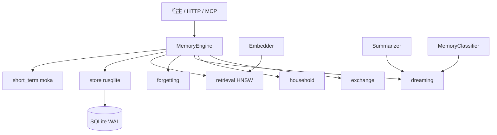

# Memora 技术文档

本地优先、可嵌入的记忆引擎。短期记忆是会话工作集，长期记忆可检索、可演进、可追溯。调用模型前只组装受 token 预算约束的上下文包，而不是把历史消息整段塞回提示词。

本文描述当前实现（库 `memora` 0.1.0，工作区成员 `memora-server`、`memora-mcp`）。JNI 构建见 [jni.md](jni.md)，MCP 接入见 [mcp.md](mcp.md)。

## 1. 产物与边界

| Crate | 形态 | 职责 |
| --- | --- | --- |
| `memora` | `rlib` + `cdylib` | 记忆引擎。不启动 HTTP，不捆绑 Web UI |
| `memora-server` | 二进制（不发布） | Axum HTTP + 内嵌 Web UI，默认 `127.0.0.1:8787` |
| `memora-mcp` | 二进制（不发布） | stdio MCP，供 Cursor 等 Agent 调用 |

工作区 `default-members` 只包含库本身。在仓库根目录执行 `cargo build` / `cargo test` 不会编译 server 与 MCP。

库默认不下载模型、不强制 LLM。`Embedder`、`Summarizer`、`MemoryClassifier` 由宿主注入。未注入时：

- 无 `Embedder`：写入仍成功，召回退化为 FTS/BM25，记忆标记 `embedding_pending`。
- 默认摘要器为 `ExtractiveSummarizer`（抽取式，零网络）。
- 默认分类器为 `HeuristicClassifier`（零 LLM）。

库本身不启动后台循环。宿主调用 `spawn_maintenance` 才周期 `tick`，调用 `spawn_dream` 才周期 `dream`。`memora-server` 按配置代为启动这两条循环。



## 2. 模块

```text
src/
  lib.rs           稳定再导出
  engine.rs        MemoryEngine / EngineBuilder，写入、召回、tick、dream
  types.rs         MemoryService 与公开数据类型
  config.rs        默认参数
  error.rs
  store.rs         SQLite 仓储、FTS、migration、审计链
  short_term.rs    moka 三区与沉淀队列
  retrieval.rs     hnsw_rs 向量索引
  embedding.rs     Embedder / HashEmbedder / Summarizer
  classify.rs      MemoryClassifier / HeuristicClassifier
  forgetting.rs    复习、归档、逻辑遗忘、物理清理
  dreaming.rs      近重复合并、聚类、抽取摘要
  household.rs     家庭成员名册与生活域
  qianfan.rs       OpenAI 兼容 Embedder / Summarizer / Classifier
  exchange.rs      .memora ZIP 导入导出
  core/            R(t)、RRF、jieba 分词、时间
  jni_bridge.rs    feature jni 时的 JNI 导出
```

SQLite 是同步 API。数据库与 HNSW 写入走 `spawn_blocking`。连接池 `max_size=8`、`min_idle=1`，避免启动时并行打开抢锁。每个连接设置 `journal_mode=WAL`、`busy_timeout=15000`、`foreign_keys=ON`、`synchronous=NORMAL`。

## 3. 稳定接口

```rust
pub trait MemoryService: Send + Sync {
    async fn remember(&self, input: RememberInput) -> Result<MemoryId>;
    async fn recall(&self, query: RecallQuery) -> Result<RecallResult>;
    async fn revise(&self, id: MemoryId, update: MemoryUpdate) -> Result<()>;
    async fn forget(&self, id: MemoryId, reason: ForgetReason) -> Result<()>;
    async fn explain(&self, id: MemoryId) -> Result<MemoryExplanation>;
    async fn export(&self, req: ExportRequest) -> Result<Vec<u8>>;
    async fn import(&self, archive: &[u8], mode: ImportMode) -> Result<ImportReport>;
}
```

`MemoryEngine` 额外提供：`tick`、`dream`、`rebuild_index`、`spawn_maintenance`、`spawn_dream`、`get`、`restore`、家庭成员名册读写。

`EngineBuilder` 必填 `db_path`。选填 `index_path`（默认把库文件扩展名换成 `.hnsw`）、`namespace`、`embedder`、`summarizer`、`classifier`、`config`。

最小用法：

```rust
let engine = MemoryEngine::builder()
    .db_path("memora.db")
    .embedder(Arc::new(HashEmbedder::new(64)))
    .build()
    .await?;

let id = engine.remember(RememberInput::episodic("用户偏好 SQLite")).await?;
let hits = engine
    .recall(RecallQuery { text: "SQLite".into(), ..Default::default() })
    .await?;
```

`MemoryId` 为 UUIDv7。

## 4. 数据模型

SQLite 是事实源。`embeddings.vector` 是小端 `f32` blob，只用于重建索引。HNSW 文件可丢弃，用 `rebuild_index()` 从 `embeddings` 重建。

Schema 分三次 migration：

| 版本 | 内容 |
| --- | --- |
| v1 | `memories`、`memory_fts`、`memory_versions`、`memory_relations`、`embeddings`、`audit_events`、`stm_promotions`、`dream_runs`、`pattern_observations` |
| v2 | `memories.consolidation_pending` |
| v3 | `household_members` |

认知类型 `kind`：`episodic` | `semantic` | `pattern` | `summary`。

生命周期 `state`：`active` | `archived` | `forgotten` | `superseded`。

关系 `relation`：`supports` | `contradicts` | `summarizes` | `derived_from` | `supersedes`。

「这条记忆关于谁、属于哪个生活域」不占用 `kind`，写在 `metadata` 里，并由 `household_members` 名册辅助归属。生活域白名单：`medical`、`education`、`travel`、`lifestyle`、`diet`、`finance`、`social`、`household`、`unknown`。成员角色：`self`、`spouse`、`child`、`parent`、`other`。`member_id` 不能为空，且不能包含逗号、竖线或引号。

中文全文检索：写入和查询都先用 `jieba-rs` 预分词，空格拼接后交给 FTS5 `unicode61`。

## 5. 短期记忆

三区，键为 `namespace/session_id/key`。无 session 时使用 `__default__`。

| 区 | TTL | 容量 |
| --- | --- | --- |
| `session_events` | 2 小时 | 1024 |
| `working_facts` | 3 天 | 256 |
| `query_cache` | 15 秒 | 256 |

过期且 `importance >= 0.5` 或 `pinned` 的项写入 `stm_promotions`。`tick()` 把它们 `remember` 为长期记忆（`actor=stm_promote`，`skip_consolidation=true`）。`recall` 把 working facts 命中放进 `stm_hits`，并优先进入 `ContextPack`。

## 6. 写入、修订、遗忘

**remember**

1. 写入 STM 工作集。
2. 事务写入 `memories`、FTS、`memory_versions`（operation=`create`）、审计。
3. 默认 `consolidation_pending=1`，写入后即可召回；`dream` 再按批分类巩固。
4. `skip_consolidation`、`dream_job`、`stm_promote` 不进入巩固队列。
5. 有 `Embedder` 时把 id 送入无界通道，后台 `embed_one`，不阻塞写入。
6. 若给出 `member_id` 或正文能匹配名册，把主体与生活域写入 metadata。

**revise**：版本、记忆更新、旧来源图谱撤回及新图谱任务在同一事务提交；后台只发布匹配当前 revision 的结果。仅分数等不影响图谱的修改也会刷新已有任务版本，并保留原始证据/宿主说话人。`contradicts` 建边并降低旧记忆置信度。

**forget**

- `ForgetReason::User`：逻辑删除。状态改为 `forgotten`，FTS 与 HNSW 移除，行保留。
- `ForgetReason::Purge`：无关系引用时物理删除。
- `ForgetReason::Decay`：遗忘曲线触发的逻辑删除。

## 7. 保留分数与 tick

时间单位为天：

```text
R(t) = exp(-t / S)
S    = S0 * (1 + α * importance + β * review_count)
```

默认 `S0=1.0`，`α=2.0`，`β=0.15`。

召回最终分：

```text
final = rrf * confidence * R(t) * access_boost * importance
access_boost = 1 + ln(review_count + 1) * 0.1
```

`R < 0.15` 时状态变为 `archived`（移出 FTS）。归档超过 30 天、无 relation、metadata 无 `retain` 时变为 `forgotten`。`forgotten` 再满 30 天则物理 `DELETE`，审计类型 `purge_decay`；`metadata.retain` 跳过物理删除。

`tick()` 顺序：

1. 消费 `stm_promotions` 并沉淀为长期记忆。
2. 到期复习：间隔阶梯约 1 / 3 / 7 / 16 / 35 天，每次复习增加 `review_count` 并重算下次复习时间。
3. 按 `R(t)` 归档、逻辑遗忘、宽限期后物理清理。
4. 从 HNSW 移除已归档或已遗忘的 id。
5. 把仍 `embedding_pending` 的记忆重新入队。

## 8. 混合检索

`recall` 并行取两路 Top 80：

- jieba + FTS5
- 查询向量 + HNSW（`hnsw_rs`，M=16，`ef_construct=200`，查询 `ef=64`，容量上限 100_000）

过滤命名空间、种类、时间窗、`member_id`、生活域后，用 RRF（`k=60`）融合成 Top 20，再按时间衰减重排为 Top 10（可用 `top_k` 覆盖）。

上下文包默认 token 预算 2000。中文按 `chars/2` 估算。装填优先级：

1. STM working facts
2. 原子记忆
3. 摘要 / 语义记忆
4. 沿 `derived_from` / `summarizes` 展开来源

返回 `RecallResult`：`hits`（含 `ScoreBreakdown`）、`stm_hits`、`context`（`ContextPack`）。最近一次分数缓存在 moka 中（容量 2048，TTL 1 小时），供 `explain` 读取。

### 召回片段的成员与记录时间

记忆展示统一为 `[主驾 · 记录于2026-10-26 11:20] 我有点头疼`。前缀明确表示**记录创建时间**，不是事件发生时间、最后修改时间或本次召回时间；固定中国时区 UTC+8，精确到分钟。后半段保持既有非空摘要优先/原文回退，不做第一人称改写或新的 LLM 推断，仅去掉内部事件标记。

- `hits[].display_text` 是新增展示字段；`hits[].memory.content`、`summary`、`created_at_ms` 等原始数据不变。旧 hit 缺少该字段时反序列化为 `""`。
- `context.items[].text` 的记忆项（STM、原子/摘要、来源展开）使用同一渲染器，token 预算按带前缀的完整文本计算；已有 graph_fact 展示保持原样，避免把图谱入库时间冒充来源记忆时间。
- 只使用该 namespace 内实际主体的当前成员显示名，不把查询者/说话人猜成主体。多主体以“、”连接并按成员 ID 去重；没有主体显示“未归属”，成员缺失显示原 ID。成员改名会使召回缓存失效。
- 不更新数据库正文、FTS、向量、去重依据或评分；不新增模型调用。只在原有过滤/权限校验之后附加展示。
- Web 召回卡片、API/JNI/MCP 的 context 及 MCP one-shot 采用新片段；记忆库、get/list/export 继续返回原始内容。外部客户端若仍直接显示 `memory.content`，应改读 `display_text` 或 `context.items[].text`。

回归位于 `tests/recall_display_regressions.rs`（7 项引擎回归）、`src/recall_display.rs` 和 `server/web/recall-display.test.cjs`。验证结果：隔离组件 7/7、召回界面 2/2、原 reconcile 界面 6/6 通过，格式及 diff 检查通过。完整 memora 离线测试当前受 Windows GNU 环境缺少 `dlltool.exe` 阻挡；全 workspace 离线测试另缺 `darling v0.23.0`。隔离测试直接使用真实类型、渲染器、事件标记显示函数和 MCP slim_hits，替代无关的错误/图谱/名册模型依赖；不等于 7 项引擎/数据库集成测试已通过。未安装工具链或下载依赖。

### 接口速度优化

- 普通写入/修改只等待本地事务及缓存更新；图谱由默认独立 worker 后台处理。失败任务持久保留，修改/遗忘通过版本栅栏阻止旧结果回写；`skip_graph` 为真正跳过。
- 查询向量使用独立缓存，不随记忆结果缓存失效而清空。键为 namespace＋向量空间/模型＋完整查询；默认 TTL 300 秒、容量 512。缓存不保存权限结果，每次仍检索并核验当前数据。
- 同查询请求合并；最多 3 个 provider batch 在途，每批不超过 16 条，700ms 召回预算包含排队。失败、不合法向量和维度漂移不缓存；关闭引擎时取消请求。配置项为 `query_embedding_cache_ttl`、`query_embedding_cache_capacity`、`query_embedding_max_in_flight`、`query_embedding_batch_size`。
- reconcile 使用内部轻量批量候选检索，不再对每条事实生成用户 context、展示或访问计数。保留 FTS＋向量语义分支、原有评分与全部过滤；不改抽取提示、分块、超时或权限策略。
- DEBUG 阶段日志通过 `RUST_LOG=memora::performance=debug` 启用，记录 prepare/extract/candidate/ops/write 或 STM/embedding/local-search/lock-wait/graph/presentation 的耗时与总耗时；正文、成员、查询不作为计时字段。图谱后台另区分 queue/source-load、extract-model、persist-or-retry；普通写入另记录 lock_wait_ms、persist_ms、total_ms（需同时启用 `memora::engine=debug`）。

这些改动减少前景等待和重复请求，不意味着长文档 LLM 本身已加速；应使用同一数据集比较冷/热查询、写入和抽取的 P50/P95，并同时检查事实保留率与图谱队列积压。

## 9. 梦境

`dream(DreamOptions)` 默认回看 24 小时。阶段：

1. **巩固**：取出 `consolidation_pending` 记忆（默认每批 20），带家庭名册调用 `MemoryClassifier`，更新 kind / importance / confidence / 主体 / 生活域。`importance < 0.2` 归档。
2. **去重**：正文归一化后全等，或向量余弦 ≥ 0.90，或实体 Jaccard 加软余弦。保留最新一条，其余标 `superseded`；精确重复可物理删除。
3. **聚类**：近 24 小时已巩固情景，按时间桶（默认 6 小时）∩ 实体 ∩ 余弦（阈值 0.75）聚类，最小簇大小 2。
4. **摘要**：`Summarizer` 生成 `semantic` / `summary`，写 `derived_from`、`summarizes`、`supersedes`，并按选项 supersede 源记忆。
5. **规律**：`pattern_observations` 按实体、时区、星期、小时桶累计，支持度默认 5 时生成 `pattern`。
6. 写入 `dream_runs` 与审计。

`DreamReport` 包含巩固数、低价值归档数、合并数、去重组数、簇数、规律数与产出 id。

## 10. 审计与导入导出

`remember` / `revise` / `forget` / `dream` / `import` / `promote` 都追加 `audit_events`。哈希为 `sha256(prev || payload || id || seq || type)`，形成只追加链。

`.memora` 是 ZIP，内含 `manifest.json`、`memories.jsonl`、`versions.jsonl`、`relations.jsonl`、`audit.jsonl`。导入模式：

| 模式 | 行为 |
| --- | --- |
| `merge` | 按 id 插入或更新 |
| `replace_namespace` | 先清空目标命名空间再导入 |
| `dry_run` | 只统计，不写库 |
| `reembed` | 导入后把向量标为待重嵌 |

解压拒绝 `..` 路径。未压缩体积上限默认 512 MiB。导出可排除 `forgotten`，可选择不带向量，并可排除医疗或 `sensitivity=high` 的记忆。

## 11. 嵌入与分类实现

| 实现 | 用途 |
| --- | --- |
| `HashEmbedder` | 确定性哈希向量，离线测试 |
| `ExtractiveSummarizer` | 抽取式摘要 |
| `HeuristicClassifier` | 规则分类 |
| `QianfanEmbedder` / `QianfanSummarizer` / `QianfanClassifier` | OpenAI 兼容 HTTP。名称保留千帆，实际端点由环境变量决定 |

密钥只从环境变量读取，不要写入仓库。

| 变量 | 含义 |
| --- | --- |
| `LLM_API_KEY` | 嵌入与对话的密钥 |
| `LLM_EMBED_URL` | embeddings 端点 |
| `LLM_EMBED_MODEL` | 嵌入模型名 |
| `LLM_EMBED_DIM` | 向量维度 |
| `LLM_CHAT_URL` | chat completions 端点 |
| `LLM_CHAT_MODEL` | 对话模型名 |

`memora-server` / `memora-mcp` 的 `--embedder` / `MEMORA_EMBEDDER`：`auto`（有密钥走 LLM，否则 Hash）、`hash`、`llm`、`qianfan`（与 `llm` 同义）。

## 12. HTTP 服务

```bash
cargo run -p memora-server -- --bind 127.0.0.1:8787 --db data/memora.db --namespace default --embedder llm
```

| 参数 / 环境变量 | 默认 | 含义 |
| --- | --- | --- |
| `--bind` / `MEMORA_BIND` | `127.0.0.1:8787` | 监听地址 |
| `--db` / `MEMORA_DB` | | SQLite 路径 |
| `--namespace` / `MEMORA_NAMESPACE` | `default` | 默认命名空间 |
| `--embedder` / `MEMORA_EMBEDDER` | `auto` | 嵌入后端 |
| `--tick-interval` / `MEMORA_TICK_INTERVAL` | 600 秒 | 后台 tick；0 关闭 |
| `--dream-interval` / `MEMORA_DREAM_INTERVAL` | 180 秒 | 后台 dream；0 关闭 |

主要路由：`GET /health`、`GET /status`、`GET|POST /memories`、`GET|PATCH /memories/{id}`、`GET /memories/{id}/explain`、`POST /memories/{id}/forget`、`POST /memories/{id}/restore`、`POST /recall`、`POST /reconcile`、`POST /tick`、`POST /dream`、`GET /export`、`POST /import`、`POST /rebuild-index`、`GET|POST /household/members`、`DELETE /household/members/{member_id}`、`GET|POST /household/tags`、`POST /graph/person`、`GET|POST /graph/overview`、`POST /graph/ingest`、`GET|POST /graph/grants`、`POST /graph/grants/revoke`。静态页面由二进制内嵌资源提供。`POST /reconcile` 对齐 Android `reconcileMemoraTurn`（extract → evidence → ops → remember）；`remember/revise` 将图谱任务与记忆事务提交后返回（有 `LLM_API_KEY` 时由后台 `QianfanGraphExtractor` 处理），不等图谱完成；`GET /graph/overview` 供 Web 力导向总览；`recall` 返回 `graph_hits`。

## 13. MCP

`memora-mcp` 在进程内嵌入同一个 `MemoryEngine`，经 stdio 暴露：

`remember`、`recall`、`get_memory`、`list_memories`、`revise_memory`、`forget_memory`、`restore_memory`、`explain_memory`、`tick`、`dream`、`status`、`upsert_member`、`list_members`、`remove_member`。

删除家庭成员只删名册，不删该成员已有记忆。配置样例见 `.cursor/mcp.json.example`，Agent 使用约定见 `.cursor/skills/memora-memory/`。

## 14. JNI

feature `jni` 下 `cdylib` 导出 `com.aiwf.memory.memora.MemoraNative`（create / destroy / remember / recall）。交叉编译在 WSL 中进行，产物放到 `java/workflow/src/main/resources/natives/<platform>/`。步骤见 [jni.md](jni.md)。

## 15. 默认参数一览

| 项 | 默认 |
| --- | --- |
| 沉淀阈值 | `importance >= 0.5` |
| FTS / HNSW 候选 | 各 80 |
| RRF k / 融合条数 / 返回条数 | 60 / 20 / 10 |
| token 预算 | 2000 |
| 归档阈值 `R` | 0.15 |
| forgotten 宽限 | 30 天（归档→遗忘、遗忘→物理删除各一段） |
| 梦境候选 / 最小簇 / 时间桶 | 500 / 2 / 6 小时 |
| 聚类余弦 / 去重余弦 / 实体 Jaccard | 0.75 / 0.90 / 0.3 |
| pattern 支持度 | 5 |
| 巩固批大小 / 低分归档 | 20 / `importance < 0.2` |
| HNSW | M=16，ef_construct=200，ef=64，max_layer=16，max_elements=100_000 |
| 导入体积上限 | 512 MiB |

集成示例：`examples/embedded.rs`（`cargo run --example embedded`）。

图谱使用中文具体关系、带来源的家庭上下文推理及严格批内实体引用；详见 [图谱抽取约定](graph-extraction.md)。
