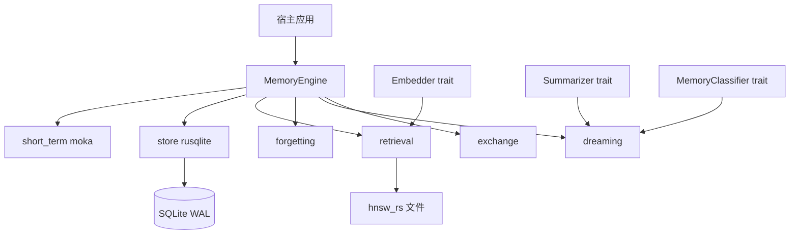

# Memora 记忆引擎技术方案

本地优先、可嵌入 Rust 应用的记忆引擎。不是把历史消息塞回 LLM 上下文：短期记忆是会话工作集，长期记忆可检索、可演进、可追溯；调用模型前只组装受 token 预算控制的上下文包。

## 产物与边界

- 单一 crate `memora`，对外稳定 API：`MemoryEngine` / `MemoryService` / `EngineBuilder`。
- 不做 CLI / axum / gRPC。
- 默认不下载模型、不强制 LLM。`Embedder` / `Summarizer` / `MemoryClassifier` 由宿主注入。
- 梦境默认使用 `ExtractiveSummarizer`（抽取式）与 `HeuristicClassifier`（零 LLM）。
- 库默认不 spawn 后台循环；`spawn_maintenance(interval)` 才启动 tick，`spawn_dream(interval)` 才启动定时 dream。



## 稳定接口

```rust
pub trait MemoryService: Send + Sync {
    async fn remember(&self, input: RememberInput) -> Result<MemoryId>;
    async fn recall(&self, query: RecallQuery) -> Result<RecallResult>;
    async fn revise(&self, id: MemoryId, update: MemoryUpdate) -> Result<()>;
    async fn forget(&self, id: MemoryId, reason: ForgetReason) -> Result<()>;
    async fn explain(&self, id: MemoryId) -> Result<MemoryExplanation>;
    async fn export(&self, req: ExportRequest) -> Result<Vec<u8>>;
    async fn import(&self, archive: &[u8], mode: ImportMode) -> Result<ImportReport>;
}

impl MemoryEngine {
    pub fn builder() -> EngineBuilder;
    pub async fn tick(&self) -> Result<TickReport>;
    pub async fn dream(&self, opts: DreamOptions) -> Result<DreamReport>;
    pub async fn rebuild_index(&self) -> Result<()>;
    pub fn spawn_maintenance(&self, interval: Duration) -> JoinHandle<()>;
}
```

`EngineBuilder` 必填 `db_path`。选填：`index_path`、`namespace`、`embedder`、`summarizer`、`config`。无 embedder 时写入仍成功，召回降级为纯 BM25，并标记 `embedding_pending`。

SQLite 为同步 API：DB / HNSW 写走 `spawn_blocking`，连接池 + WAL + `busy_timeout=5000` + `foreign_keys=ON`。

## 模块

```text
src/
  lib.rs           稳定再导出
  error.rs / types.rs / config.rs / engine.rs
  core/            评分 R(t)、RRF、时间、jieba 分词
  short_term.rs    moka 三区 + 沉淀
  store.rs         rusqlite 仓储与 migration
  retrieval.rs     HNSW
  embedding.rs     Embedder / HashEmbedder / Summarizer
  classify.rs      MemoryClassifier / HeuristicClassifier
  forgetting.rs    艾宾浩斯归档
  dreaming.rs      聚类 + 抽取摘要
  qianfan.rs       千帆 Embedder / Summarizer / Classifier
  exchange.rs      .memora ZIP
```

## 数据模型

`MemoryId` 为 UUIDv7。SQLite 是事实源；`embeddings.vector` 为小端 f32 blob，仅用于重建；HNSW 是可丢弃检索层。

表：`memories`、`memory_fts`、`memory_versions`、`memory_relations`、`embeddings`、`audit_events`、`stm_promotions`、`dream_runs`、`pattern_observations`。

- `kind`: `episodic | semantic | pattern | summary`
- `state`: `active | archived | forgotten | superseded`

中文 FTS：写入与查询均用 `jieba-rs` 预分词，空格拼接后交给 FTS5 `unicode61`。

## 短期记忆

三区（key = `namespace/session_id/key`）：

- `session_events`：TTL 2h，容量 1024
- `working_facts`：TTL 3d，容量 256
- `query_cache`：TTL 15s，容量 256

过期且 `importance >= 0.5` 或 `pinned` 的项写入 `stm_promotions`。`tick()` 将其 `remember` 为情景记忆。`recall` 会把 working_facts 命中放入 `stm_hits` 并优先进入 ContextPack。

## 写入 / 更新 / 遗忘

- **remember**：写入 STM 工作集（无 session 时用 `__default__`）+ LTM（默认 `consolidation_pending=1`，可立即召回）；事务写 memories + FTS + version(create) + audit；embedding 入队不阻塞。`dream_job` / `stm_promote` / `skip_consolidation` 跳过巩固排队。
- **revise**：写 version 后更新投影；`contradicts` 建边并降低旧记忆置信度。
- **forget(User)**：逻辑删除（FTS/HNSW 移除，行保留）。
- **forget(Purge)**：无关系引用时物理删除。

保留分数（时间单位：天）：

- `R(t) = exp(-t / S)`
- `S = S0 * (1 + α * importance + β * review_count)`，默认 `S0=1.0`，`α=2.0`，`β=0.15`
- 召回：`final = rrf * confidence * R(t) * access_boost * importance`
- `R < 0.15` → `archived`；归档超过 30 天、无 relation、无 `metadata.retain` → `forgotten`；`forgotten` 再满 30 天 → 物理 DELETE（审计 `purge_decay`，`metadata.retain` 跳过）

`tick()`：沉淀 STM、到期复习（间隔约 1/3/7/16/35 天）、归档、逻辑遗忘。

## 混合检索

并行：jieba+FTS5 Top80 与 embed+HNSW Top80 → 过滤 → RRF(k=60) 融合 Top20 → 时间衰减重排 Top10 → token 预算（默认 2000，中文按 `chars/2`）组装 ContextPack。

优先级：STM working_facts → 原子记忆 → 摘要/语义 → 沿 `derived_from`/`summarizes` 展开来源。

HNSW：`hnsw_rs`，M=16，ef_construct=200，查询 ef=64。崩溃后 `rebuild_index()` 从 `embeddings` 重建。

## 梦境与规律

`dream()`：先对 `consolidation_pending` 记忆按批调用 `MemoryClassifier` 更新 kind/importance/confidence，低分归档；再对活跃记忆做近重复合并（正文归一化全等 / 向量余弦≥0.90 / 实体 Jaccard+软余弦），保留最新一条并将其余标为 `superseded`；再选取近 24h 已巩固情景 → 时间桶∩实体∩余弦聚类（最小簇 2）→ `Summarizer` 生成 semantic/summary，写 `derived_from`/`summarizes`/`supersedes` 并 supersede 源记忆 → `pattern_observations` 生成 `pattern` → 写 `dream_runs` 与审计。

## 审计与导入导出

所有 remember/revise/forget/dream/import/promote 写入仅追加 `audit_events`，`hash = sha256(prev||payload||id||seq||type)`。

`.memora` 为 ZIP：`manifest.json`、`memories.jsonl`、`versions.jsonl`、`relations.jsonl`、`audit.jsonl`。模式：`merge` / `replace_namespace` / `dry_run` / `reembed`。拒绝 `..` 路径与解压炸弹。

## 配置默认

- 沉淀阈值 `importance >= 0.5`
- 召回 FTS/HNSW 各 80，RRF k=60，返回 10
- 遗忘 `R_archive=0.15`，archived→forgotten 与 forgotten→DELETE 宽限均为 30 天
- 梦境候选 500，簇最小 2，近重复合弦阈值 0.90，pattern 支持度 5
- 巩固批大小 20，低分归档阈值 `importance < 0.2`

## 宿主集成

见 [`examples/embedded.rs`](examples/embedded.rs)。`MemoryEngine` 另提供 `get` / `restore` / `tick` / `dream` / `rebuild_index` / `spawn_maintenance`。

嵌入与抽象摘要通过 trait 注入。内置：

- `HashEmbedder` / `ExtractiveSummarizer` / `HeuristicClassifier`：离线、零网络，适合测试。
- `QianfanEmbedder` / `QianfanSummarizer` / `QianfanClassifier`：百度千帆 OpenAI 兼容接口。密钥只从环境变量读取，不要写进仓库。

```text
LLM_API_KEY=...
LLM_CHAT_URL=https://qianfan.baidubce.com/v2/chat/completions
LLM_EMBED_URL=https://qianfan.baidubce.com/v2/embeddings
LLM_CHAT_MODEL=qwen3.5-27b
LLM_EMBED_MODEL=qwen3-embedding-8b
```

单元测试覆盖评分、分词、聚类、哈希向量、引擎 CRUD/召回/导入导出/梦境/tick。真实千帆调用见 `cargo test -- --ignored`。
